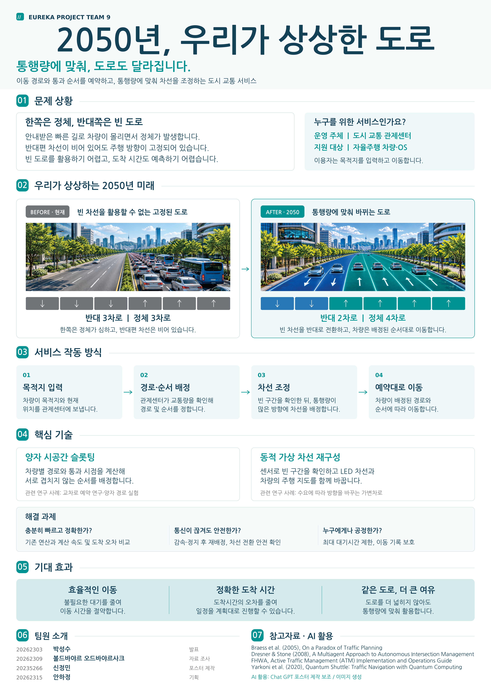

# Welcome to E26-SW01-09

## 🎯 팀 슬로건

> 모두의 commits, 하나의 release

## 🖼️ 팀 포스터

<div class="poster"></div>

<p><a href="poster.pdf"> 포스터 PDF 보기 및 다운로드</a></p>

***

## 1️⃣ 팀원 소개

| **이름** | **전공** | **관심사** |
| --- | --- | --- |
| **신정민** | 소프트웨어전공 | 로보틱스,  |
| **박성수** | 소프트웨어학부 | 보안, 프론트엔드, 백엔드, 인공지능 |
| **안하정** | 소프트웨어학부 | 알고리즘, 프론트엔드, 게임 개발 |
| **볼드바야르 오드바야사크** | 소프트웨어학부 | 컴퓨터 하드웨어, 모바일 앱, 게임 개발 |

유레카프로젝트 팀 생성을 축하합니다.
팀의 제목과 슬로건, 팀원의 이름 및 관심사를 변경하세요.

### 팀 소개

팀의 소개를 작성합니다.

***

## 2️⃣ 공통된 관심사 : 게임, 

***

## 3️⃣ 한학기 동안의 활동 내역 

- 기관/부서 인터뷰 ✔️  

- 현장 탐방 ✔️  

- 멘토링 ✔️  
  - 내 지도 교수 함게 만나기
  - 대학원 방문 및 선배 만나기

- 프로젝트 진행 ✔️  
  - 과거에 사람들이 상상한 미래
  - 그들이 만들어가는 세상
  - 우리가 상상한 미래
  - 우리가 그리는 미래 그리고 나

- 각오와 소감 나누기 ✔️  


<!-- 활동 사진 추가 예시 -->


***

## 4️⃣ 인상 깊은 활동

- 활동명 – 활동에 대한 간단한 설명과 배운 점을 작성  
- 예: 멘토링에서 실리콘밸리 현업 경험을 들을 수 있어 진로 방향 설정에 큰 도움이 되었다.  

***

## 5️⃣ 특별히 알아보고 싶은 것
- 예: 현장실습 제도
- 예: 학부 졸업 인증 조건
- 예: 성취기반평가
- 예: 졸업 후 진로(대학원/취업)

***

## 6️⃣ 활동을 마친 소감

🔗학번 이름  
> "소감 내용을 여기에 작성합니다."

🔗학번 이름  
> "소감 내용을 여기에 작성합니다."

🔗학번 이름  
> "소감 내용을 여기에 작성합니다."

🔗학번 이름  
> "소감 내용을 여기에 작성합니다."

🔗학번 이름  
> "소감 내용을 여기에 작성합니다."


## Markdown을 사용하여 내용꾸미기를 익히세요.

Markdown은 작문을 스타일링하기위한 가볍고 사용하기 쉬운 구문입니다. 여기에는 다음을위한 규칙이 포함됩니다.

```markdown
Syntax highlighted code block

# Header 1
## Header 2
### Header 3

- Bulleted
- List

1. Numbered
2. List

**Bold** and _Italic_ and `Code` text

[Link](url) and 
```

자세한 내용은 [GitHub Flavored Markdown](https://guides.github.com/features/mastering-markdown/).

### Support or Contact

readme 파일 생성에 추가적인 도움이 필요하면 [도움말](https://help.github.com/articles/about-readmes/) 이나 [contact support](https://github.com/contact) 을 이용하세요.

## AI를 활용한 문제 상황 구체화

- **Before**

2050년에 자율주행 자동차가 보편화되더라도, 모든 차량이 각자의 내비게이션에 따라 가장 빠른 경로를 선택하면 특정 도로에 차량이 집중되어 오히려 교통체증이 심해질 수 있다. 또한 출퇴근 시간대 등 방향별 교통량이 불균형한 상황에서도 기존 도로는 고정된 차선으로 운영되어 비효율적인 교통 흐름이 발생한다.

- **프롬프트 1**

"2050년에 자율주행 자동차가 보편화되었다고 가정할 때, 모든 차량이 개별적으로 최단 경로를 선택하여 발생하는 교통체증과 방향별 교통량 불균형 문제의 핵심 원인 및 사용자 요구사항을 추상화하여 다시 정의해줘."

위 상황의 핵심 문제와 사용자 요구사항을 추상화하여 다시 정의해줘.

- **프롬프트 2**

"사용자, 상황, 문제, 기대효과가 명확히 포함되도록 작성해줘."

- **After**

**사용자:** 2050년 자율주행 자동차를 이용하는 시민과 도시 교통 통제 센터

**상황:** 시민은 자율주행 자동차를 이용하여 목적지까지 이동한다. 각 차량은 개별적으로 가장 빠른 경로를 선택하지만, 특정 도로에 차량이 집중되면서 오히려 전체 이동 시간이 증가하는 상황이 발생한다. 또한 방향별 교통량이 불균형하더라도 기존 도로의 차선은 고정되어 있어 교통 수요에 유연하게 대응하기 어렵다.

**문제:** 현재의 개별 차량 중심 경로 선택 방식은 도시 전체의 교통 효율성을 고려하지 못하며, 특정 도로에 차량이 집중되는 브라이스의 역설과 방향별 교통량 불균형 문제를 발생시킨다. 이로 인해 불필요한 대기 시간과 이동 시간의 증가, 도착 시간 예측의 어려움이 발생한다.

**기대효과:** 도시 중앙제어 시스템이 자율주행 차량의 경로와 통과 순서를 통합적으로 관리하고, 실시간 교통량에 따라 가상 차선을 유연하게 재구성한다면 차량의 도로 집중을 분산하고 기존 도로를 효율적으로 활용할 수 있다. 이를 통해 시민은 보다 예측 가능한 이동 시간을 확보하고, 도시는 전체적인 교통 흐름을 최적화할 수 있다.
